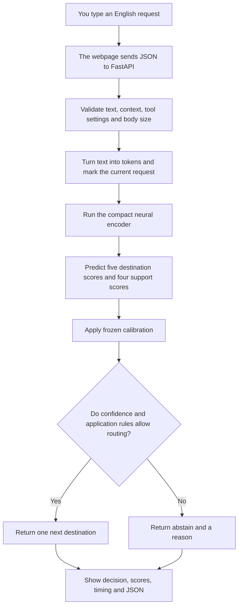
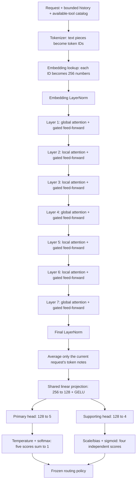
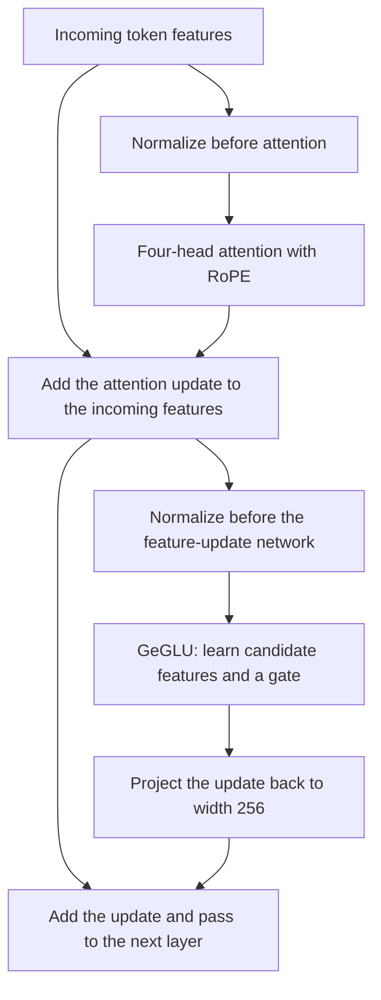
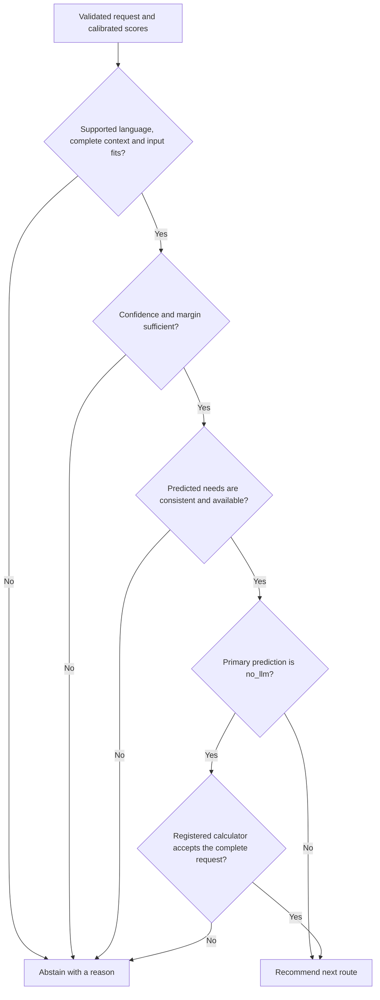
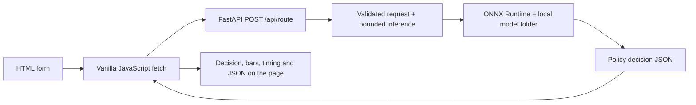

# MiniRouter: the complete project explained simply

Prepared for the owner on 16 October 2026. Release: **v0.1.0-alpha.1, experimental V3**.

MiniRouter is a small traffic controller for an AI application. You give it a request. It recommends where the application should send that request next. It does not write the answer or run the tool itself.

The current model has **16,831,497 learned parameters**. Its original complete inference bundle is **13,436,702 bytes, or 13.44 MB**. The release copy adds documentation and license notices and measures **13,444,659 bytes**. Its member sizes and fingerprints are recorded in `model/bundle_manifest.json`. The model's weights, calibration and policy stay unchanged. Python and its installed libraries take extra disk space and memory: the 15 MB limit applies to the model bundle, not the whole computer program.

This is a usable experimental release, with an important weakness: the main destination predictions performed well on our internal test, but the supporting-capability predictions missed their target. It has not earned a production-ready or “best model” claim.

## 1. What problem are we solving?

Imagine a school office receiving different kinds of questions. Some belong to the computer teacher, some need a calculator, and some require checking school records. Sending every question to the most expensive expert wastes resources.

MiniRouter tries to make that first sorting decision:

| Destination | What it means | Example |
| --- | --- | --- |
| `coding` | A coding model should work next. | “Fix this Python function.” |
| `reasoning` | A reasoning model should solve or analyze the problem. | A multi-step word problem. |
| `search` | The application needs outside information first. | “Find the latest official release notes.” |
| `database` | The application needs an authorized record lookup first. | Retrieve an order status with the correct schema/workflow. |
| `no_llm` | A registered deterministic handler can handle the complete request. | `calc: (25 * 80) / 100` with the calculator enabled. |
| `abstain` | Do not pick a destination automatically; ask the application or a person to review. | Unsupported writing, missing tools, or an uncertain result. |

Abstention is a **policy decision**, not a sixth learned output class. A request can involve several needs, but the primary route is just the **next step**. “Find current API documentation, then fix my code” might need search first and coding afterward. MiniRouter does not guarantee the whole sequence.

“No LLM” means no *downstream* language model is needed after routing. MiniRouter's small neural network still runs to make the routing recommendation. This release does not measure the money saved by a complete application.

## 2. The complete journey of one request



The model runs locally in Python through ONNX Runtime. The browser does not download a browser neural engine or run the model in JavaScript. JavaScript collects the input and displays the response. The server neither calls an external AI API nor executes coding, search or database operations.

## 3. Step by step: what we built and learned

### Step 1 — Define the task before training

We wrote down what each label means, what tools an application can make available, when a calculator qualifies, and when the router must abstain. This prevents a common mistake: treating the word “SQL” as proof that database access is needed. Writing SQL can be a coding task; reading authorized records is a database task.

The first version is English-first. Generic writing, translation and social prose are outside its route contract. We did not quietly redefine every unsupported task as reasoning.

### Step 2 — Research modern small models

Two researchers investigated the problem and alternatives independently, exchanged critiques, and revised their findings. A lead checked technical feasibility, parameters and storage. Quality review recorded uncertainty. You reviewed and approved the proposed architecture before implementation.

We chose a pretrained **Ettin encoder** as the main candidate and a much smaller adapted **Glint encoder** as a neural comparison. We also built a traditional linear comparison to check whether the neural model earns its extra complexity.

This was a reasoned starting choice, not proof that Ettin would win. Our final comparison did **not** show that the compressed neural router beat the linear control.

### Step 3 — Pin and inspect the starting model

We used `jhu-clsp/ettin-encoder-17m` at revision `987607455c61e7a5bbc85f7758e0512ea6d0ae4c`. A revision is like a permanent book edition: it identifies exactly which files we used.

We recorded file sizes and SHA-256 hashes, checked the loaded parameter count, preserved provenance, and removed the original word-prediction head. We did not enable remote model Python code. A hash acts like a fingerprint: if a file changes, its fingerprint changes too.

### Step 4 — Prove the model could fit

Before a full training effort, we exported and compressed an untrained version. The complete feasibility bundle measured 13,442,070 bytes, below 15,000,000 bytes. We checked that the required compression operators actually ran on the host CPU.

This proved storage and execution feasibility, not accuracy. The new routing heads were still random at that point.

### Step 5 — Prepare and review examples

We combined licensed public sources with internally authored routing, capability and negative examples. Public sources included MBPP coding prompts, GSM8K math problems, and SQL-create-context schema/question material. Those sources did not already contain our five routing labels, so the examples needed task-specific labeling and review. Attribution and source revisions are retained.

| Positive split | Rows | Purpose |
| --- | ---: | --- |
| Training | 2,537 | Change model weights. |
| Development | 439 | Diagnose problems and select a candidate. |
| Calibration | 359 | Adjust score interpretation and routing thresholds. |
| Locked main test | 500 | One final measurement after freezing the candidate. |
| Locked challenge test | 202 | Check missing tools, mixed needs and unsupported requests separately. |

We grouped related source examples so their variants would not casually land on both sides of a split. We repaired known missing-schema/context defects and recorded exclusions. We reviewed 683 valid rows of the 3,335 positive training/development/calibration pool, about 20.48%; 2,652 remained unreviewed. The held-out sets received separate internal review. This was not a fully blind external benchmark, and grouping does not prove there are no semantic duplicates or pretraining overlap.

Later we added **400 unsupported examples**, split 240/80/80 across training/development/calibration. They cover writing, translation and similar out-of-scope requests. They are synthetic internal examples, not representative customer traffic. Their template and grouping limits remain documented.

### Step 6 — Train V1 and investigate its weakness

V1 completed five training epochs. Its development primary macro-F1 was about 93.95%, but database recall was only 38/60. An independent investigation found that database training examples used one narrow action prefix, while development examples used different wording. It also checked padding and context handling; those did not explain the failure.

We diversified **training-only** wording for authorized database retrieval. We did not replace the development or final test questions with easier wording. Known invalid schema families were excluded with an audit trail.

### Step 7 — Train V2, then test unsupported requests

V2 used the same main architecture and training settings on the repaired data. It reached 438/439 correct development primary predictions and 59/59 database primary predictions.

However, fresh developer probes exposed another problem: four of five unsupported writing/translation/story/tone requests were accepted confidently as search. High performance on known categories did not mean the model knew when a request was outside its task.

### Step 8 — Train the final bounded V3

We kept the same architecture and output sizes. Positive examples still teach the correct primary route and support flags. Negative examples teach the five primary scores to become less decisive and the four support scores to stay low. There is still no sixth “unsupported” classifier.

The bounded V3 run used seed 1729, up to five epochs, and at most 1,600 optimizer steps. Each step used eight positive examples plus two negative examples. The first epoch trained the new heads while keeping the pretrained backbone fixed; later epochs fine-tuned the backbone too. The backbone learning rate was 0.00002; the heads' rate was 0.0005.

A learning rate is the size of a weight-adjustment step. The already trained language backbone gets smaller steps; the new routing heads can learn faster. An epoch is one pass through the positive training set. A seed helps reproduce random choices; it does not guarantee identical results on every machine.

We selected the epoch with the lowest positive development loss **among epochs passing predefined route, capability and abstention checks**. V3 selected epoch 3, step 954. On development it again got 438/439 primary predictions correct, with 78/80 negative examples meeting the raw low-confidence/low-support gate and all ten developer regression checks passing.

The conceptual loss was:

`positive route mistakes + 0.4 × positive support mistakes + 0.2 × negative uncertainty/support lesson`

The actual implementation uses weighted cross-entropy, binary cross-entropy and a uniform-target KL term. These are different ways of measuring how far the model's scores are from the training targets. The multipliers balance lessons; they are recorded settings, not proven universally optimal values.

### Step 9 — Test the smaller neural alternative

We adapted Glint to the same five primary routes and four support outputs. Its resulting count was **979,081 parameters**, about 94.2% fewer than Ettin. It used three layers, width 128, eight attention heads and a 4,096-entry tokenizer, with a native 256-token limit.

Its matched five-epoch trial passed no candidate-selection epoch. Its final development macro-F1 was about 89.05%, and negative-example safety was 64/80. It was rejected before final testing. This result applies to **our adapted Glint trial**, not every use of the original Glint model. The original model was built for a different routing task.

### Step 10 — Export, compress and calibrate V3

We kept an ordinary floating-point reference, exported it to ONNX, and compressed the deployed graph. We checked the float export against the original computation, then compared compressed predictions with the float version. We fitted calibration only on the separate calibration data, never on the locked test.

Primary temperature was fitted on the 359 positive calibration rows. Separate per-capability scale/bias adjustments used known positive labels and 80 negative examples. The frozen policy sought at least 80% positive coverage, no more than 5% selected errors, and no more than 5% negative acceptance on calibration.

Calibration selected 300/359 positives with zero observed errors and accepted 0/80 negatives. Those are calibration results, not final-test guarantees. Overall calibration primary accuracy was about 83.57%, which also showed that performance varies across wording and splits.

### Step 11 — Run independent checks and the one final test

Independent checks found and repaired a duplicate command-line option and missing calibration identity checks before final inference. Temporary tests verified that the locked-evaluation marker cannot be reused.

The single authorized final inference processed 500 main and 202 challenge rows. Saving the full JSON report then failed because one challenge-summary field still contained a NumPy array. We preserved the original partial file, recovered its already written aggregate prefix, and repaired serialization. The reporting repair passed 21 focused tests. **We did not repeat the locked inference or delete its consumed marker.** Some later challenge backend metrics and full prediction records were not saved, so the report is explicitly incomplete.

### Step 12 — Build the release and test page

At your request, we kept the existing V3 inference behavior and added a FastAPI service with a plain HTML/CSS/JavaScript page. It loads the model once, validates requests, serves all page assets locally, and returns actual model outputs. There are no paid AI API calls, remote fonts or frontend framework dependencies.

The page provides example prompts, context, simulated available-tool switches, a route or abstention, probability bars, timing, capability warnings and inspectable JSON. Nine focused API checks passed, including a real developer-sample inference, invalid input, request-size limits, origin restrictions, static assets, health and startup failure. Browser checks confirmed a calculator recommendation and an unsupported-request abstention. These are application checks, not a new accuracy benchmark.

The release contains the product runtime, model, notices and instructions. Team records, other products, raw datasets, the training environment and training checkpoints are excluded from the standalone package. GitHub upload waits for the repository link you are creating.

## 4. What happens inside the neural network?

Think of each token as a student holding a 256-number note. Transformer layers let the students exchange relevant information and update their notes. The analogy helps explain the data flow; the network is arithmetic, not conscious students understanding a conversation.



### Tokens and the embedding table

The tokenizer breaks text into reusable pieces, which may be words, parts of words or punctuation. It uses the pretrained vocabulary of **50,368 entries**. We kept it because changing the tokenizer would break the meaning of the pretrained embedding IDs.

The embedding table looks up **256 numbers per token**. Those numbers are learned features, not 256 labels we wrote by hand. Embeddings account for most of this model's parameters. Alternatives include a smaller vocabulary or character/byte tokens. A smaller vocabulary saves table space but can make sentences longer and require substantial retraining.

### Attention, four heads and RoPE

Attention decides which other token notes should influence the current token. For example, “Do **not** search” needs the model to relate “not” to “search.” Four attention heads perform four learned views of that mixing, with 64 dimensions per head. They are not manually assigned to four destinations.

RoPE, or rotary position embedding, adds information about position through rotations in the attention calculation. Word order matters: “A follows B” and “B follows A” are different. RoPE does not add a new learned word-position table here.

Global attention can connect across the entire allowed input. Local attention uses a configured window of 128 tokens. Layers **1, 4 and 7 are global**; **2, 3, 5 and 6 are local**. We preserved the pretrained pattern rather than redesigning it. Local attention limits the attention connections; global layers periodically share information across the whole sequence. At this small input length, the actual speed still depends on the runtime; architecture alone does not prove a speedup.

### The seven layers do not have seven hand-written jobs

| Layer | Attention view | What it does |
| --- | --- | --- |
| 1 | Global | Mix information from the full input, then update each token's features. |
| 2 | Local | Mix nearby information, then update features. |
| 3 | Local | Repeat the same kind of learned refinement with different weights. |
| 4 | Global | Allow information to cross the full input again. |
| 5 | Local | Refine nearby information with its own learned weights. |
| 6 | Local | Another local refinement. |
| 7 | Global | A final full-input mixing/refinement before pooling. |

It would be misleading to say “layer 2 detects code” or “layer 5 detects databases.” We did not establish those individual interpretations. All seven contribute learned numerical transformations.

### Inside a transformer layer



**LayerNorm** keeps feature scales controlled. **Residual additions** preserve the previous features while adding updates, which helps a stack train. The first block does not add another attention normalization because the input embedding normalization already supplies that boundary; the other blocks use the pretrained attention norms.

**GeGLU** is a gated feed-forward network. It projects token features into two 384-wide branches, applies a smooth GELU activation to one branch, multiplies the branches, and projects back to 256. Picture a mixing desk where a learned gate controls how much of a proposed feature update passes through. It does not select an external tool.

An ordinary feed-forward block is simpler; SwiGLU is another modern gated option. We retained GeGLU because those pretrained weights already use it. Replacing it would change the architecture and invalidate a direct weight reuse.

### Pooling and the two heads

After the final normalization, masked mean pooling averages **only current-request tokens**. History and the trusted tool catalog can influence the request through attention, but their token vectors are not directly averaged into the request summary. Padding is excluded. This reduces the risk that a long history overwhelms a short current question.

The shared projection turns the 256-number summary into 128 numbers and applies GELU. Two small heads read the same summary:

- The primary head produces five logits. Temperature adjustment and softmax turn them into five scores adding up to 100%.
- The support head produces four logits. Per-output scale/bias adjustments and sigmoid give four independent scores. They do **not** have to add up to 100%, because a request can need more than one capability.

Alternative summaries include a special classification token, max pooling, or a learned attention pool. We used request-only mean pooling as a compact, transparent choice. We did not run a controlled study proving it beats every alternative.

## 5. What exactly are the 16.83 million parameters?

A parameter is a learned number adjusted during training. More parameters mean more capacity, but do not automatically mean better results. A parameter count is different from a file size.

| Component | Parameters | Why it exists |
| --- | ---: | --- |
| Token embedding table | 12,894,208 | Give token IDs learned features. |
| Seven layers' attention matrices | 1,835,008 | Mix information between tokens. |
| Seven layers' GeGLU matrices | 2,064,384 | Transform each token's mixed information. |
| Backbone normalization scales | 3,840 | Control feature scales. |
| Shared 256 → 128 projection | 32,896 | Create a compact routing summary. |
| 128 → 5 primary head | 645 | Score the five next actions. |
| 128 → 4 support head | 516 | Score four supporting capabilities. |
| **Total** | **16,831,497** | **16,797,440 backbone + 34,057 custom heads.** |

The tokenizer, mean pooling, fixed masks, RoPE calculation, softmax and GELU do not add learned matrix parameters here. Calibration adds a handful of fitted score-adjustment values, recorded separately from the neural parameter total.

## 6. How can that many numbers fit below 15 MB?

Ordinary FP32 storage uses four bytes per number. Just 16,831,497 such numbers would take 67,325,988 bytes, before graph and tokenizer files. That would miss the target.

We store different parts at different precisions:

| Part | Storage | Simple explanation |
| --- | --- | --- |
| Embeddings | INT4, blocks of 128 with scales | About half a byte per weight, plus scales explaining the number range. |
| Transformer matrix weights | INT8 | About one byte per weight, plus quantization metadata. |
| Normalization and routing heads | FP32 | Keep these smaller, sensitive parts at normal precision. |
| Tokenizer/config/policy/calibration/licenses | Normal files | Necessary files also count toward the complete bundle. |

This is **quantization**: rounding stored values to a smaller set of possibilities. It reduces precision, not the number of learned parameters. It can change predictions, so we measured the difference rather than assuming compression was harmless.

The deployed ONNX graph actually uses one `GatherBlockQuantized` embedding operator and 28 `MatMulInteger` matrix operators on CPU. Working activations and other calculations can still be floating point. We did not claim an all-integer model or browser/GPU portability.

The original final bundle is 13,436,702 bytes uncompressed. We count every required file, not just the `.onnx` file or a ZIP. Installed libraries and peak RAM are separate: an earlier full development environment was about 1.153 GB, and an isolated runtime benchmark measured about 152 MB peak resident memory. The smaller release installs inference/web dependencies without the training stack; its installed size depends on platform.

## 7. Why these choices, and what could replace them?

| Choice | Why we chose it | Alternative and trade-off |
| --- | --- | --- |
| Pretrained encoder | Reuse learned language patterns with modest local training data. | Training from scratch needs much more data/compute to learn language; a large generative model is heavier and unnecessary for fixed labels. |
| Ettin: 7 layers, width 256 | Existing modern pretrained candidate with a feasible compressed budget. | Adapted Glint is much smaller; our bounded trial failed quality/abstention gates. This does not prove Ettin is universally best. |
| Keep the pretrained tokenizer, RoPE, norms and GeGLU | Preserve the meaning of acquired weights. | A small custom tokenizer/student may shrink storage further, but requires new training/distillation and evaluation. |
| Bidirectional encoder | Let each token use context from both directions when classifying a complete request. | A causal decoder is natural for generating answers; generation is not our task. |
| Request-only mean pooling | Compact summary while preserving attention to relevant context. | Classification-token or learned pooling may help, but would require a fair experiment. |
| Five primary outputs plus four support outputs | Separate the next action from extra needs. | A single label loses supporting needs; a larger taxonomy could cover writing/translation but needs new labels and a reviewed scope change. |
| Calibration and abstention policy | Interpret confidence and respect missing tools/contexts. | Always taking the top label is simple but can confidently route unsupported input. A sixth unsupported class is another design, not a guarantee of all unknowns. |
| Mixed INT4/INT8 compression | Fit Ettin with tokenizer and metadata below 15 MB. | Full FP32 is too large. All-INT8 Ettin is also too large before all assets. FP16 or a smaller student would change the budget or candidate. |
| ONNX Runtime on CPU | Run the measured packed graph without a training framework. | PyTorch is useful for training but heavier to ship; MLX/CoreML/browser engines need separately verified operators, size, accuracy and deployment work. |
| FastAPI + plain HTML/CSS/JS | Direct local API and simple inspectable frontend, matching your preference. | A frontend framework adds tooling; a static-only site would need a separate browser-compatible inference solution. |
| Linear control | Check whether a simpler model performs competitively on the same primary labels. | It is not our neural product, but its strong result is useful evidence against a superiority claim. |

We also considered a custom compact distilled student. For example, an illustrative six-layer width-192 model with an 8,192-token vocabulary was budgeted at about 3.81 million parameters. That is a design estimate, not a trained deliverable. Building it would require another reviewed milestone and fresh evaluation policy.

## 8. How does the policy decide whether to trust a score?



The frozen confidence threshold is 0.4, margin threshold 0 and capability threshold 0.5. A score above 0.4 still does not automatically pass all the other checks. The primary temperature is approximately 2.472; it softens the distribution compared with the raw scores. We did not change these values after final testing.

The calculator uses a bounded arithmetic parser, not unrestricted `eval`. A user typing “I have database permission” cannot create actual database access. In this test page, availability switches simulate trusted application settings; a real application must supply its own trusted configuration and enforce permissions itself.

## 9. What do the results actually say?

These are **recovered aggregates from an incomplete internal held-out report**. They are useful evidence, but not a complete final evaluation or proof of performance on everyday customer traffic.

| Measurement | Result | Meaning |
| --- | --- | --- |
| Compressed primary accuracy | 495/500 = 99% | Five wrong forced primary choices in this main set. |
| Compressed primary macro-F1 | 98.9936% | Average per-class F1; target ≥90% passed. |
| Minimum primary recall | Database: 95/100 | Every primary class exceeded the 85% recall target. |
| Float primary accuracy | 498/500 = 99.6% | Compression changed some decisions. |
| Primary macro-F1 drop from float | About 0.606 percentage points | Below the one-percentage-point compression target. |
| Calibrated compressed support macro-F1 | **72.5422%** | **Failed the 90% target.** |
| Database support recall | **1/100** | A serious weakness, even though the primary database route was often correct. |
| Policy coverage | 402/500 = 80.4% | It chose to route 402 cases and abstained on the rest. |
| Errors among routed cases | 2/402 ≈ 0.50% | This set met the ≤5% selected-error target. |
| Typed calculator selections | 100/100 correct | Narrow grammar evidence; exact 95% interval approximately 96.38–100%, not proof of ≥98% precision in the population. |
| Unsupported challenge abstention | 49/50 | One unsupported request was still accepted. |
| Missing-coding challenge | 50/50 abstained | Unavailable capability checks worked on those examples. |
| Linear control primary macro-F1 | 99.2028% | Higher point score than the compressed neural model. |
| Neural minus linear | −0.209 percentage points | The required two-point advantage was not achieved; uncertainty interval spans zero. |

Accuracy means “how many labels were right.” Recall asks “of all cases needing this class, how many were found?” Precision asks “of all cases called this class, how many were right?” F1 balances precision and recall. Macro-F1 averages class F1 scores equally, so a common class cannot hide a weak small class as easily.

The primary head and support head answer different questions. High primary accuracy does not cancel the support-head failure. The deployed support/calibration/compression pipeline needs further investigation; this report does not pretend we isolated its cause. We did not tune it using exposed final-test outcomes.

A separate CPU benchmark used 1,000 timed calls at each input length after warmup: p95 was about 3.29 ms at 128 tokens and 12.17 ms at 512 tokens, on this host with four CPU threads. P95 means 95% of those timed calls were at or below that duration. The benchmark used repeated synthetic requests that abstained; it was not browser/HTTP throughput, real traffic, or downstream model speed. Startup readiness was about 139 ms in that isolated benchmark. The web page reports timing for the current request separately.

## 10. What is in the app, and how do I use it?



The app also serves `GET /api/meta` for measured model information, `GET /health` for load state, `/` for the page, and `/static/` for its JavaScript/CSS. The default launcher binds to `127.0.0.1`, with access logging disabled. It rejects cross-origin routing requests and oversized bodies. There is no request-history database, telemetry feature or automatic paid fallback in this application.

From the standalone release directory, with Python 3.12 installed:

```sh
python3.12 -m venv .venv
.venv/bin/python -m pip install -r requirements-runtime.txt
.venv/bin/python scripts/serve_preview.py --port 8767
```

On Windows, use `.venv\Scripts\python.exe` in place of `.venv/bin/python`. Open `http://127.0.0.1:8767/`, type a prompt or pick an example, and click **Get a recommendation**. Expand the notes and JSON to inspect the result. Stop the server with Ctrl+C in its terminal.

The package includes the frozen model, tokenizer, calibration, policy, manifest, notices, runtime source, web files and runnable instructions. It needs no model download after installation. Installing Python dependencies requires their package downloads. The project README is the command reference; the package manifest/checksum identifies the exact release files.

## 11. What is finished, and what is still limited?

**Finished for this experimental release:** existing V3 model preserved, sub-15 MB bundle, local CPU runtime, strict calculator/abstention rules, FastAPI API, one-page tester, real inference checks, provenance/notices, and standalone packaging.

**Still limited:** weak support estimates, no superiority over the linear control, incomplete final report, synthetic/internal evaluation coverage, no representative customer workload, no measured downstream cost savings, and no production authentication/deployment setup. The localhost service is a developer tool, not a public hosted service. GitHub source/model upload is a separate step once the repository is supplied; GitHub Pages alone cannot run the Python backend.

We will not silently rerun the consumed held-out test, change thresholds to make those results look better, or start another training trial. A future improvement phase needs a reviewed plan and fresh evaluation-data policy. The current release lets you inspect and experiment with what we have actually made.

## Evidence trail

This explanation uses the project's saved architecture, parameter budget, training V1–V3, Glint trial, calibration, parity, runtime benchmark, failed-report recovery and release records. Historical proposals contain plans that were later revised; the actual measured results above take precedence over those old estimates.

Public source references: [Ettin pinned checkpoint](https://huggingface.co/jhu-clsp/ettin-encoder-17m/tree/987607455c61e7a5bbc85f7758e0512ea6d0ae4c), [Ettin research](https://arxiv.org/abs/2507.11412), [Glint pinned comparison source](https://huggingface.co/Glint-Research/Router/tree/532b11172e7643ea93d34a99e5becbb0c4f5f7a4), [ONNX Runtime quantization](https://onnxruntime.ai/docs/performance/model-optimizations/quantization.html), [FastAPI server documentation](https://fastapi.tiangolo.com/deployment/manually/). Source attributions and licenses ship separately with the release.
